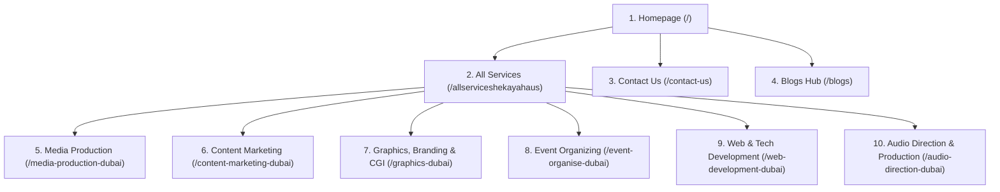

# Hekaya Haus — Master Project Context & Knowledge Base

> **File Purpose**: Master Context File for the Antigravity AI Agent and Development Team.  
> **Last Updated**: 2026-09-02  
> **Current Workspace**: `e:\hekaya haus`  
> **Original Site URL**: [https://www.hekayahaus.com](https://www.hekayahaus.com)  

---

## 1. Executive Summary

**Hekaya Haus** (`HekayaHaus FZC-LLC`) is an ultra-premium creative media, marketing, production, and technology agency ("Haus") based in Dubai, UAE, operating across the UAE, GCC, and India.

- **Brand Philosophy**: *"Born from creativity, built on culture. Hekaya Haus transforms ideas into identity that lasts beyond the screen."*
- **Slogan**: *"Beyond Seen, Into Felt — Where Stories Become Legacies"*
- **Distinction**: Positioned not merely as a marketing agency, but as a multi-disciplinary **"Haus"** where cinematic storytelling, high-end film production, CGI/VFX, cutting-edge software engineering, and AI automation converge.
- **Notable Brand Partners & Clients**:
  - Global Village
  - Porsche
  - Nike
  - EA Sports
  - Red Bull
  - Lamborghini
  - Hero MotoCorp
  - Farak

---

## 2. Why This Workspace Exists & Current Objective

1. **Current State**:
   - The live website was originally built using **Framer** (`framerusercontent.com` project ID `5QynPxwSyHGrBg8sPJZcxK`).
   - The workspace link / Framer access expires today, necessitating an urgent, zero-data-loss extraction and archival.
2. **Upcoming Task**:
   - Rebuild the entire website from scratch.
   - Upgrade the design to be cleaner, more sophisticated, and more editorial.
   - Implement fluid, high-end animations (e.g., GSAP ScrollTrigger, Lenis smooth scrolling, split-text typography reveals, dynamic cursor interactions, interactive bento grids).
   - Ensure blazing performance, clean code architecture, and modular UI components.
   - Seamlessly connect all inquiry forms, Google Calendar booking, and socials.

---

## 3. Site Navigation & Route Hierarchy

The website consists of **10 key routes**:

---

## 4. Key Reference Documents in This Repository

| Document | Description |
| :--- | :--- |
| [`CONTACT_AND_SOCIALS.md`](file:///e:/hekaya%20haus/CONTACT_AND_SOCIALS.md) | Official email (`info@hekayahaus.com`), calendar booking link, LinkedIn, Instagram, and inquiry form schema. |
| [`PAGES_AND_CONTENT.md`](file:///e:/hekaya%20haus/PAGES_AND_CONTENT.md) | 100% verbatim copy, headings, bullet points, CTA buttons, metrics, and all FAQ questions and answers across all pages. |
| [`ASSETS_AND_MEDIA.md`](file:///e:/hekaya%20haus/ASSETS_AND_MEDIA.md) | Image catalog (42+ images), client logos, background video MP4, YouTube showreels, WOFF2 font files, and CSS color tokens. |
| [`REBUILD_SPECIFICATION.md`](file:///e:/hekaya%20haus/REBUILD_SPECIFICATION.md) | Rebuild plan, animation choreography, component architecture, and tech stack options. |
| [`raw_data/`](file:///e:/hekaya%20haus/raw_data/) | Local cache of all raw HTML files, 36 downloaded Framer JS module chunks, and parsed JSON files. |

---

## 5. Contact & Social Coordinates (Quick Reference)

- **Official Inquiry Email**: `info@hekayahaus.com`
- **Appointment / Discovery Call Booking**: `https://calendar.app.google/49AJM36qdqkp8zaG6`
- **Instagram**: `https://www.instagram.com/hekayahaus/`
- **LinkedIn**: `https://www.linkedin.com/company/hekayahaus-fzc-llc/`
- **YouTube Main Showreel**: `https://youtu.be/2_CSwS6nG6o`
- **YouTube Playlist**: `https://www.youtube.com/playlist?list=PLk53-jXewhhfX-5Pxq_Ywe3ByEmBkgEgJ`

---

## 6. Design System & Aesthetics Tokens

- **Atmosphere**: Cinematic Dark Luxury, Frosted Glass (glassmorphism), High-contrast typography, Micro-grain texture overlay.
- **Palette**:
  - Deep Pitch Black: `#000000`
  - Dark Charcoal Cards: `#141414`, `#171717`, `#1c1c1c`
  - Primary Accent Gold: `#b27f1f` / `#f3a80a` (with alpha glows `rgba(243, 168, 10, 0.25)`)
  - Accent Orange: `#FF4D00` (`rgb(255, 77, 0)`)
  - High Contrast Text: `#FFFFFF` / `rgba(255, 255, 255, 0.85)`
  - Muted Text / Meta: `rgba(255, 255, 255, 0.45)`
- **Typography**:
  - Hero Headings: **Syne** or **Clash Display**
  - Section Titles / Sub-headings: **Satoshi**
  - Body & FAQs: **Inter** / **Instrument Sans**
  - Badges & Accents: **Bricolage Grotesque** / **Aldrich**

---

## 7. Instructions for AI Resuming Work

When the user returns to start the rebuild:
1. **Do not re-scrape**: All data, copy, assets, logos, and tokens are already fully extracted and preserved locally in this directory.
2. **Review user's UI changes**: The user will provide design instructions, preferred tech stack (e.g. Next.js / Vite + React / Vanilla JS), and animation specifics.
3. **Reference the documents**:
   - Use [`PAGES_AND_CONTENT.md`](file:///e:/hekaya%20haus/PAGES_AND_CONTENT.md) for all text and copy.
   - Use [`ASSETS_AND_MEDIA.md`](file:///e:/hekaya%20haus/ASSETS_AND_MEDIA.md) for images, videos, and logos.
   - Use [`CONTACT_AND_SOCIALS.md`](file:///e:/hekaya%20haus/CONTACT_AND_SOCIALS.md) for linking up forms, socials, and bookings.
